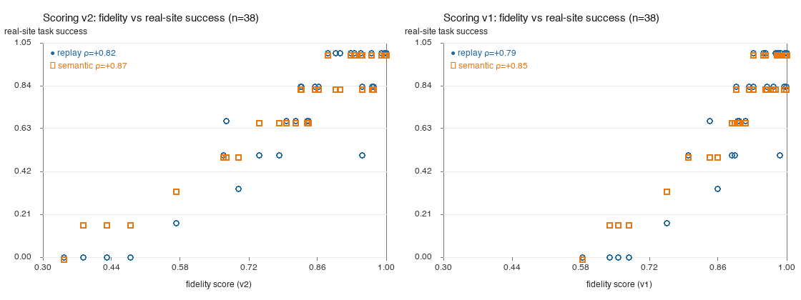
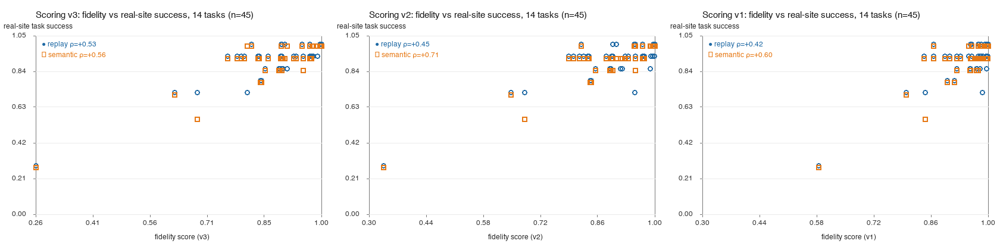

# Agent correlation (SPEC §9.3)

**These are proxy agents, not RL-trained policies.** Neither uses an LLM. Each one "trains" on a clone by breadth-first search over visible links and buttons, filling form fields from the task data by label, until a programmatic success check passes. Max 5 clicks deep, 60 expansions. The trajectory it finds is then replayed on the real Harbor Air.
- **Replay agent:** records page coordinates of each click and field, plus the typed values.
- **Semantic agent:** records role + accessible name, with an index among equals, plus field labels.

**Tasks (6), with their success checks on the real site:**
- `book_core`: reach /review for DCA→SJU via the Core fare.
- `fare_rules`: Fare rules dialog open.
- `check_in`: "Your trip" page for ABC123 / Lovelace.
- `baggage_info`: reach /help/baggage from home.
- `sign_in_page`: reach /signin from results.
- `search_bos_mco`: results for BOS→MCO.

The agents never click Pay, Delete, Purchase, Buy or Remove. Sanity check: trained and evaluated on the real site itself, both agents score 6/6.

**Clones (38):**
- the real site itself (n = 1 of the 38);
- 14 single-defect clones;
- 13 nested cumulative-sweep clones;
- 3 tiers;
- drift;
- the rebuilt clone, its 4 single-defect variants and all-4.

Fidelity scores for the same configurations come from `python validate.py`. Commands: `python tools/agents.py --workers 3` (about 10 min), then `python tools/correlate.py`.

## Headline numbers

| Subset | n | Agent | ρ v2 (p) | ρ v1 (p) |
|---|---|---|---|---|
| all clones | 38 | replay | +0.82 (5e-10) | +0.79 (4e-09) |
| all clones | 38 | semantic | +0.87 (2e-12) | +0.85 (2e-11) |
| non-nested clones | 25 | replay | +0.60 (0.001) | +0.55 (0.004) |
| non-nested clones | 25 | semantic | +0.72 (6e-05) | +0.68 (0.0002) |

Bootstrap 95% intervals (25 non-nested clones):

| Agent | ρ v2 | ρ v1 | ρ(v2) − ρ(v1) |
|---|---|---|---|
| replay | [+0.24, +0.84] | [+0.16, +0.84] | [−0.12, +0.25] |
| semantic | [+0.40, +0.88] | [+0.33, +0.87] | [−0.13, +0.24] |

## What this shows
- Higher fidelity goes with higher real-site success for both proxy agents. The relationship is clearly positive, ρ ≈ 0.6–0.7 on the 25 non-nested clones.
- For the pair that motivated Task 3, the clones that work perfectly score 1.00 success with both agents: drift (v2 0.990, v1 0.953) and the rebuilt clone (0.997, 0.984). clone_high, with its relabel, scores 0.83. **v2 orders these correctly and v1 does not.**
- Which defects break which agent is sensible:
  - A 48px layout shift breaks the coordinate-based replay agent: 3/6 tasks fail, while semantic stays at 6/6.
  - A relabel breaks the semantic agent but not the replay one. Example: `rb_relabel_find` fails check-in for semantic only.

## What this does not show
- **v2 is not shown to predict agent success better than v1.** The bootstrap interval for the difference includes 0. v2's advantage is the ordering of specific pairs, not a better overall correlation.
- **There is some circularity.** Three of the six tasks (book, fare rules, check-in) are also audit flows, and v2 penalises the high and medium gaps those flows produce. On the other three tasks only, ρ drops to +0.44 (replay) and +0.50 (semantic) under v2, and +0.49 and +0.60 under v1 (non-nested clones; full table in `runs/agents/RESULTS.md`). v1 is nominally higher there.
- **The score cannot see what matters to one kind of agent.** `layout_shift_hero` scores 0.951 (v2) because its gaps are only low and visual, yet it halves the replay agent's success. Severity rules that ignore click-target movement under-penalise this for coordinate-based agents.
- **The task set limits what can be detected.** `remove_nav_manage` scores 0.881 but costs the agents nothing, because no task uses Manage trips.
- **The sample is not independent.** All clones derive from one site and one set of 18 hand-planted defects. The 13 sweep clones are nested, which inflates the n = 38 numbers; use the n = 25 rows.
- **These are not learning agents.** Their "training" is search, and their "policy" is a fixed trajectory, so generalisation (what RL agents do) is not tested. Real agents may be more robust to small shifts and renamed labels, or less.
- Nothing here has been run on a real Frist clone.

---

# Phase 2 (2026-11-13): 14 tasks, held-out and draft clones, three scoring versions

Commands: `python tools/agents.py --workers 3`, then `python tools/correlate.py`. Scores come from `python validate.py --scoring v3,v2,v1`, `--heldout` and `--draft`. Full per-clone table: `runs/agents/RESULTS.md`; data: `docs/agent_results_phase2.json`.

**What changed from Phase 1:**
- 8 more tasks, 14 in total. Seven share no step with any audit flow ("no-flow-overlap": baggage_info, sign_in_page, sort_results, help_centre, modify_search, manage_trips, back_from_review). The tags were fixed before the run (DECISIONS D19).
- 45 non-nested clones: the 25 from Phase 1, 20 held-out clones (10 defects × template and rebuilt) and the independent first-draft clone, minus the real-vs-real point.
- Both agents still score 14/14 when trained on the real site.
- Still proxy agents: scripted search plus replay, no LLM, no learning.

## Spearman ρ, fidelity score vs real-site success (bootstrap 95% CI, 2000 resamples)

| Analysis | n | Agent | v3 | v2 | v1 | ρ(v3) − ρ(v2) CI |
|---|---|---|---|---|---|---|
| (a) all 14 tasks | 45 | replay | +0.53 [+0.27, +0.72] | +0.45 [+0.18, +0.68] | +0.42 [+0.14, +0.67] | [−0.05, +0.21] |
| (a) all 14 tasks | 45 | semantic | +0.56 [+0.31, +0.76] | +0.71 [+0.50, +0.84] | +0.60 [+0.37, +0.78] | [−0.29, −0.03] |
| (b) 7 no-flow-overlap tasks | 45 | replay | +0.23 [−0.09, +0.51] | +0.26 [−0.03, +0.53] | +0.29 [−0.01, +0.55] | [−0.16, +0.10] |
| (b) 7 no-flow-overlap tasks | 45 | semantic | +0.10 [−0.21, +0.40] | +0.20 [−0.10, +0.47] | +0.17 [−0.14, +0.45] | [−0.22, −0.02] |
| (c) held-out clones, all tasks | 20 | replay | +0.19 [−0.26, +0.59] | +0.24 [−0.21, +0.60] | +0.30 [−0.14, +0.64] | [−0.33, +0.16] |
| (c) held-out clones, all tasks | 20 | semantic | +0.61 [+0.32, +0.80] | +0.76 [+0.52, +0.87] | +0.67 [+0.38, +0.84] | [−0.36, +0.00] |
| (c′) held-out clones, no-flow tasks | 20 | replay | +0.09 [−0.33, +0.50] | +0.25 [−0.17, +0.60] | +0.27 [−0.16, +0.62] | [−0.37, +0.00] |
| (c′) held-out clones, no-flow tasks | 20 | semantic | −0.26 [−0.58, +0.06] | −0.09 [−0.42, +0.26] | −0.09 [−0.45, +0.32] | [−0.38, +0.00] |

Scores in this table are the ones regenerated after Task 11 (the behaviour layer gained select and dialog checks). Against the original Task 10 computation, a few cells moved by 0.01; no conclusion changed.

## Plain reading

- **v3 does not beat v2 on (b) or on (c).** On every one of those rows v3's ρ is lower than v2's. For the semantic agent the difference is significant on (a) and (b): the interval for ρ(v3) − ρ(v2) excludes 0. v3 was not changed in response to these results.
- **v3's one gain** is the replay agent on all tasks (+0.53 vs +0.45), which is what it was designed for, and that gain is not significant (interval includes 0).
- **Why v3 hurts the semantic agent:** v3 charges a medium gap for every click target that moved more than 20px. A semantic agent finds elements by role and name, so those moves cost it nothing, and the extra penalties are noise for it. Knock-on moves make this worse: `tpl_ho_extra_baggage_calc` drops from 0.953 (v2) to 0.897 (v3), yet both agents complete 14/14 tasks on it.
- **The circularity suspicion from Phase 1 is confirmed.** On the 7 tasks that share nothing with the audit flows, no scoring version predicts success: every interval in (b) includes 0, or just touches it. Most of the Phase 1 correlation came from tasks that are also audit flows.
- **The score cannot see task relevance.** The draft clone scores 0.820 under v3, but both agents complete all 14 tasks on it. `rebuilt_rb_broken_about` scores 0.949 with a dead link that no task uses. Fidelity as audited and usefulness for a given task set are different things.
- **The layout-shift criterion from Task 8 still holds on this data, narrowly.** With 14 tasks the clones with no agent failure are a different set (10 clones, including the draft). `layout_shift_hero` scores 0.809 under v3, below the lowest of them (draft, 0.820). v2 and v1 still fail it.

## Caveats specific to Phase 2

- Four tasks in the first full run failed for infrastructure reasons (three 30 s page-load timeouts, one `ERR_NETWORK_CHANGED`), probably because the machine slept mid-run. I re-ran those four clones; the numbers above use the clean rerun. The contaminated file is kept at `runs/agents/results_with_infra_errors.json`.
- Success values are coarse. With 7 tasks a clone's no-flow success takes one of 8 values, and most clones sit at 1.00 or 0.86, so rank correlations there are fragile.
- The held-out clones are single-defect clones, so their scores cover a narrow range.

## Final numbers (scores after Phase 3 Task 15)

`python tools/correlate.py` re-run on the final validation scores (agent outcomes unchanged). Only the "all tasks" row moves noticeably. The no-flow and held-out conclusions are unchanged: every no-flow interval includes 0.

| Analysis | Agent | v3 | v2 | v1 |
|---|---|---|---|---|
| (a) all 14 tasks, n = 45 | replay | +0.55 [+0.31, +0.73] | +0.47 [+0.21, +0.69] | +0.42 [+0.14, +0.67] |
| (a) all 14 tasks, n = 45 | semantic | +0.59 [+0.33, +0.77] | +0.73 [+0.55, +0.85] | +0.60 [+0.37, +0.78] |
| (b) 7 no-flow tasks, n = 45 | replay | +0.23 [−0.08, +0.51] | +0.26 [−0.03, +0.53] | +0.29 [−0.01, +0.55] |
| (b) 7 no-flow tasks, n = 45 | semantic | +0.11 [−0.21, +0.40] | +0.20 [−0.10, +0.47] | +0.17 [−0.14, +0.45] |

Plot: `docs/img/correlation_final.png`. Why the correlation is weak: `docs/CORRELATION_DIAGNOSIS.md`. What predicts failures instead: `docs/TASK_PREDICTION.md`.
