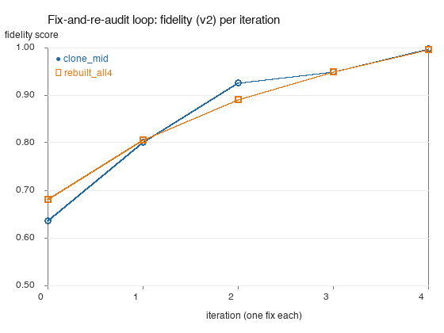
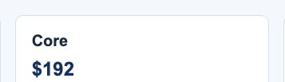

# Clone Fidelity Auditor: presentation notes

Audience: Frist engineers and researchers. Every number below comes from a run in this repo on macOS (Darwin arm64), 2026-11-12 to 2026-11-14, and each section names the command that produced it. Spoken version: `docs/TALK_TRACK.md`. Slide outline and assets: `docs/slides/deck_outline.md`. One page for people who won't attend: `docs/SUMMARY.md`. Design history: `docs/DECISIONS.md` (D1–D30).

## 1. The problem

Frist trains computer-use agents in clones of real web apps. A clone that differs from the real site teaches the wrong things:
- an agent trained on a relabelled button looks for a label that doesn't exist on the real site;
- a coordinate-based agent clicks where a button used to be.

Today fidelity is judged by eye. This tool compares a clone with the real site automatically and lists every difference as a ticket with a screenshot from each site. A full audit of 7 pages × 2 viewports + 3 flows takes about 18 s locally (median 17.9 s, two audits in parallel); `--quick` takes about 4 s.

The test bed is "Harbor Air", a fictional airline we host ourselves, so no live third-party site is touched. There are three kinds of clone:
- **template clones:** the real app with known defects switched on;
- **a rebuilt clone:** written from screenshots and visible page information only;
- **a first-draft clone:** written by a separate agent in about 3 minutes from the same observations, never rendered in a browser, and committed without polishing.

## 2. The four layers (one sentence each)

- **Visual:** full-page screenshots at desktop and mobile widths are compared pixel by pixel after masking prices, dates and clocks, and each changed region is re-checked under the best ±3px shift, so small alignment drift doesn't count.
- **Elements:** every visible link, button, field and heading (role, accessible name, position) is matched between the two sites, giving missing, extra, relabelled and moved elements; elements that moved together are reported as one ticket.
- **Behavior:** each matched link and button is clicked on a fresh page on both sites, each select option is chosen, and buttons inside any dialog that opens are clicked once, comparing where it went, the HTTP status, any dialog and whether the content changed; Pay, delete and buy are never clicked.
- **Flows:** scripted tasks (book a flight up to but not including Pay; open the fare rules; check in) are replayed step by step on both sites, and the first step where they diverge is reported.

Each ticket has a severity (high, medium or low), the page, and structured fields naming the element or flow step. The 0–1 number weighs those tickets into an **audit-coverage summary**. Scoring `v3` is the default; `v2` and `v1` are selectable (see DECISIONS D6–D10, D16, D30).

## 3. How we validated it

Commands: `python validate.py` (114 audits, ~23 min), `python validate.py --heldout` (~10 min), `python validate.py --draft` (~1 min); or `make validate`. Tables: `docs/VALIDATION.md`, `docs/HELDOUT.md`, `docs/draft_review.md`, `docs/rebuilt_review.md`.

| Test | What it shows | Result (v3) |
|---|---|---|
| Real site vs itself, 3 runs | No noise | 1.000, **0 tickets** each run |
| 14 defects planted in the real app, one at a time | Recall on known defects | **14/14** found |
| 4 defects planted in the screenshot-rebuilt clone | Recall on top of realistic rebuild noise | **4/4** found; the rebuilt clone alone has 0 high/medium tickets |
| 0 → 14 defects added cumulatively | The number moves the right way | Falls monotonically, 1.000 → 0.269 |
| **10 held-out defects**, written by a separate agent that saw only the app code, frozen in git before any audit | Generalisation to defects I never saw | **9/10** found on the template clone, **9/10** on the rebuilt clone; 0 noise tickets |
| **First-draft clone** from a separate agent | A realistic agent-made clone | 1 medium + 14 low tickets, every one a real difference (hand-checked) |

**False alarms.** Across the held-out set and the first-draft clone, no high or medium ticket was a false alarm. Every ticket I read by hand pointed at a real difference: on the draft, all 15; on the held-out set, every high or medium ticket outside the defect's expected list (each a real knock-on effect, such as a link pushed down by an inserted element).

**What it misses.** A faint colour-only change (held-out `ho_promo_tint`) is invisible to every scoring version.

**Stability.** Three full validation runs back to back gave identical scores with no crashes. The tool now records every retry it makes: in the final run, 0 page loads were retried and 27 behaviour clicks were re-measured after a one-sided timeout.

## 4. What we learned: the single number does not predict agent success

Commands: `python tools/agents.py --workers 3`, then `python tools/correlate.py` and `python tools/diagnose.py`. Details: `docs/AGENT_CORRELATION.md`, `docs/CORRELATION_DIAGNOSIS.md`.

**Experiment.**
- Two scripted proxy agents, with no LLM and no learning: a **replay** agent that records click coordinates, and a **semantic** agent that records role and name.
- Each learns 14 tasks on a clone by search and is then tested on the real site.
- 45 clones that aren't nested variants of each other.
- Seven of the tasks share no step with the audit's own flows.

**Result.** On those seven tasks, Spearman ρ between the score and real-site success is:
- replay: +0.23 [−0.08, +0.51] (v3), +0.26 (v2), +0.29 (v1);
- semantic: +0.11 [−0.21, +0.40] (v3), +0.20 (v2), +0.17 (v1).

Every interval includes zero. On all 14 tasks ρ is +0.42 to +0.73, but half of those tasks are audit flows, so that number is partly circular.

**Why** (Task 13 diagnosis):
- **Defects are mostly off the task's path.** Only 19 of 315 (clone, task) pairs have a defect on an element the task uses. A clone's number falls for defects the task never touches.
- **Ceiling.** Agents succeed on 93% (replay) and 95% (semantic) of pairs, and 29–33 of 45 clones are at 100%, so there is little variation to correlate with.
- **The information is there, but per defect.** Every failure has a defect on its path, and an on-path defect causes failure in 16 of 19 pairs. The single number averages that signal away: the median score is 0.881 for clones whose task fails and 0.898 for clones whose task succeeds.

So we call the number an audit-coverage summary, not a predictor.

## 5. What does work: reading the tickets per task

Command: `python tools/predict.py`. Details: `docs/TASK_PREDICTION.md`.

**Rule.** For each (clone, task), predict failure if the audit has a high or medium ticket on an element the task clicks or fills, or on a flow step that targets one. What a task uses comes from recording it once on the real site. The rule accounts for how each agent finds elements:
- a moved button can't hurt the name-based agent;
- a renamed button can't hurt the coordinate agent.

**Protocol.** The rule was written before the diagnosis numbers existed, developed on the 25 original clones only, and **frozen in its own commit before its first held-out run**.

**Held-out clones (20), v3, F1 with 95% bootstrap intervals:**

| Predictor | replay agent (n = 22 failing pairs of 280) | semantic agent (n = 14 failing pairs of 280) |
|---|---|---|
| **Tickets on the task's path** | **0.91** [0.79, 0.98] | **1.00** [1.00, 1.00]* |
| Overall score below a threshold (tuned on the original clones) | 0.08 [0.00, 0.11] | 0.10 [0.00, 0.12] |
| Clone has any high ticket | 0.17 [0.14, 0.21] | 0.16 [0.13, 0.19] |

\* The bootstrap interval is degenerate (all 14 failures predicted, no false positives, so every resample scores 1.00). Exact binomial 95% intervals: recall 14/14 → [0.77, 1.00], precision 14/14 → [0.77, 1.00].

On all 45 clones the same rule scores 0.93 [0.87, 0.98] (replay, n = 62) and 0.97 [0.93, 1.00] (semantic, n = 54), against 0.30–0.35 for the score threshold.

**Why v3 is the default.** Its moved-click-target tickets are what explain the coordinate agent's failures. With v2 tickets the same rule reaches only 0.62 for the replay agent on held-out (recall 0.45).

**Errors, all four read by hand:**
- 2 false positives: the predictor matches any page a task visits, not the page where it clicks.
- 2 false negatives: on the two "Modify search → Change search" clones, neither agent can even learn the task, because its success condition names the link. The predictor's replay-agent rule wrongly assumes relabels can't hurt a coordinate agent. (I first called these an artefact of my task check; a post-freeze re-run showed that was wrong and changed no outcome. See `docs/TASK_PREDICTION.md`.)

## 6. The demo

`make demo-classic` (45 s measured; `make demo` is now the generated-site demo, see README "Live demo"):
1. starts the real site and clone_mid;
2. audits it: 0.635, 2 high and 5 medium tickets;
3. switches off the defect behind the top ticket (Fare rules does nothing) and re-audits: 0.800, 1 high and 3 medium;
4. opens both reports.

What to point at in the report:
- the "audit-coverage summary" label;
- the top flow ticket with its two screenshots;
- the grouped ticket "click targets moved together";
- the structured fields in `gaps.json`.

Full fix loop (`python tools/fix_loop.py clone_mid rebuilt_all4`):



| Iteration | clone_mid | rebuilt clone + 4 defects |
|---|---|---|
| 0 | 0.635 | 0.681 |
| 1 | 0.800 | 0.806 |
| 2 | 0.925 | 0.890 |
| 3 | 0.950 | 0.949 |
| 4 | 0.997 (0 high/medium) | 0.997 (0 high/medium) |

The fixer here mostly switches off the planted defect a ticket points to, which is an answer key. One of eight fixes was a generic code edit made from the ticket text alone.

**Worked example** (`clone_mid`, medium, elements layer, page `/fares`): "Heading label reads 'Main' on clone, 'Core' on real site".

| Real site | Clone |
|---|---|
|  |  |

## 7. Next steps

1. **A real clone and its real site from Frist** (research@frist.ai). Everything here is one self-hosted fictional site. A real pair would measure false alarms in practice and test the per-task prediction on real defects.
2. **Real agents.** Repeat the per-task prediction with an LLM agent or an RL policy on Frist's own tasks. Our agents are scripted stand-ins.
3. **Record tasks on the real site once** (what each task clicks and fills), so every audit can report which tasks a clone will break, not just a list of differences.
4. **Close the known gaps:**
   - detect flat colour changes;
   - match tickets to the page where a task clicks, not any page it visits;
   - exercise text inputs and deeper dialog paths.

## What this does not show

- Nothing has been run on a real Frist clone or site.
- The agents are scripted proxies with 14 short tasks. "Tickets predict these agents' failures" is the claim, not "tickets predict what an RL agent learns".
- One designer built all three scoring versions while looking at one site. The held-out set tests unseen defects, not an unseen site.
- The first crash of the validation suite (Nov 12) was never explained. Later timeouts were traced to the laptop sleeping, fixed, and the suite has since run clean three times in a row.

## Reproduce

```bash
python3 -m venv .venv && .venv/bin/pip install -r requirements.txt && .venv/bin/python -m playwright install chromium
make test                       # 24 tests
make validate                   # original + held-out + draft, ~35 min
make demo-classic               # ~1 min (make demo: generated-site demo, ~25 s)
.venv/bin/python tools/agents.py --workers 3 --out results_traj.json   # ~25 min
.venv/bin/python tools/correlate.py && .venv/bin/python tools/diagnose.py && .venv/bin/python tools/predict.py
.venv/bin/python tools/fix_loop.py clone_mid rebuilt_all4
```

Note: `tools/correlate.py` reads `runs/agents/results.json` (the Task 10 run); `tools/diagnose.py` and `tools/predict.py` read `results_traj.json`.
